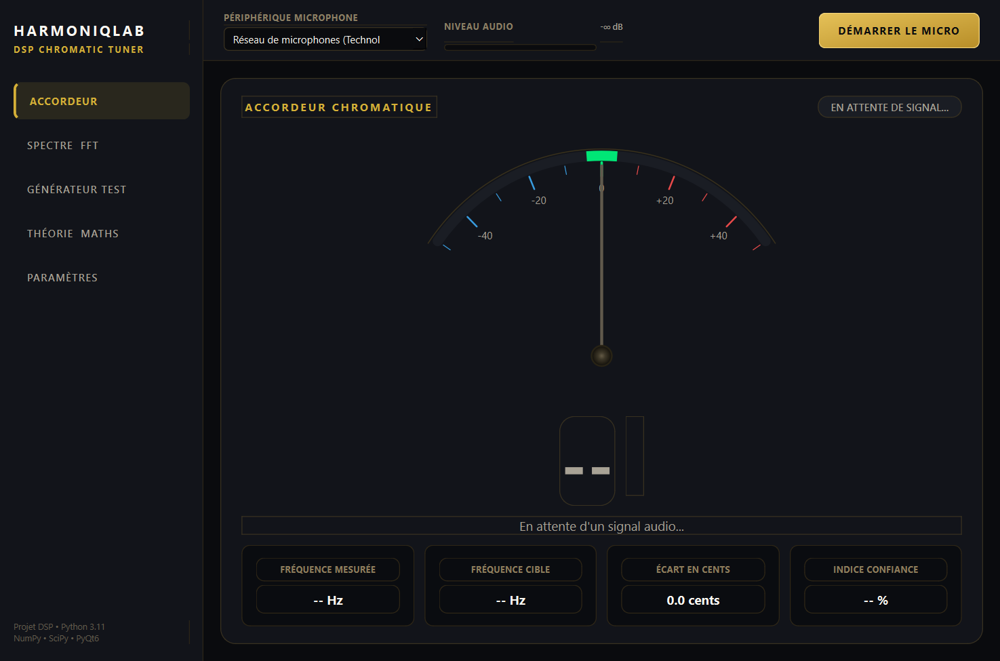
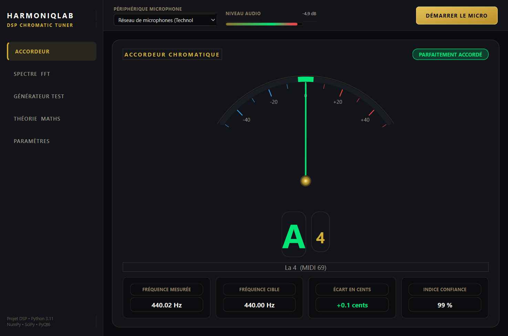
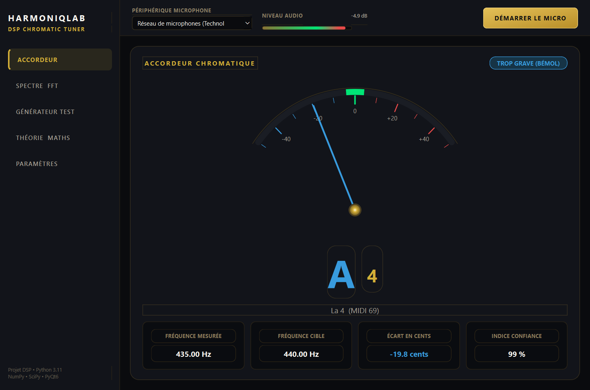
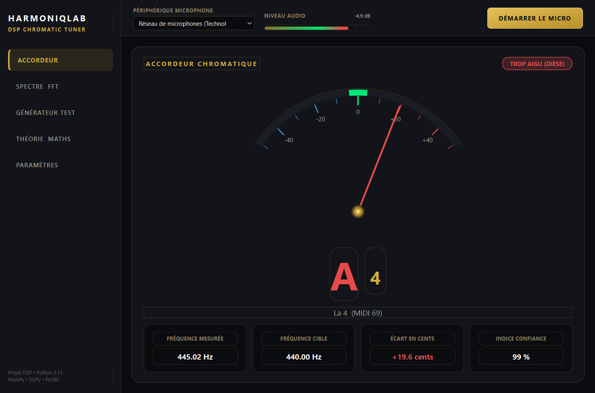
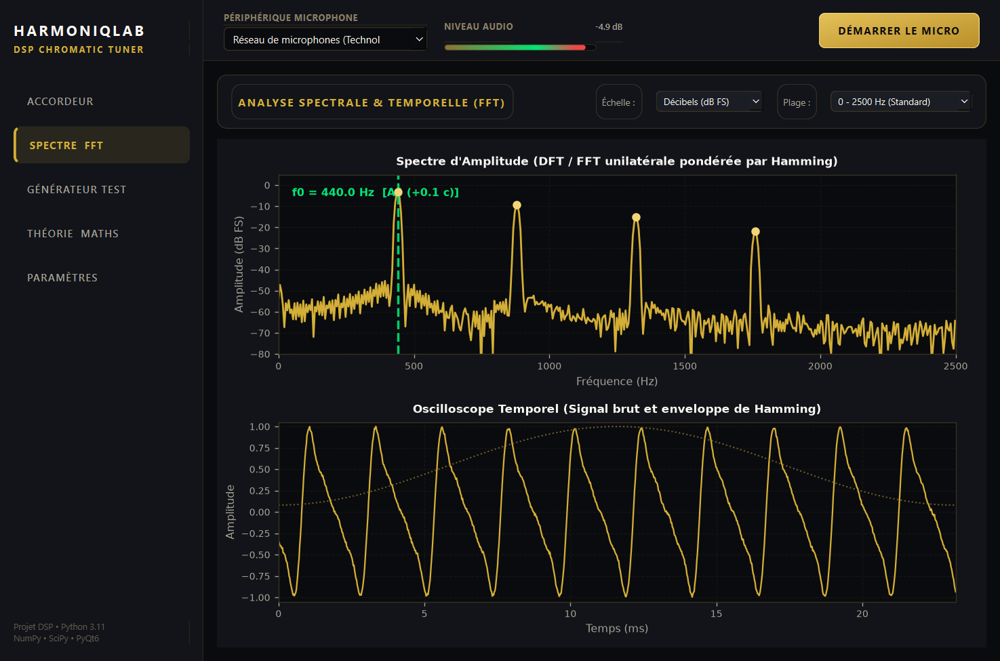
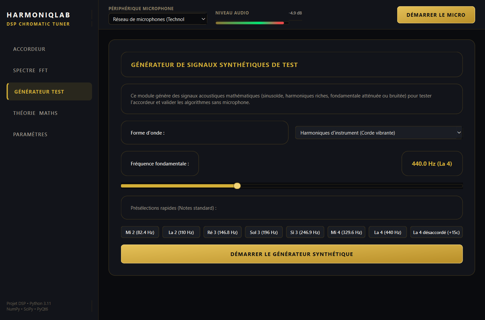

# HarmoniqLab — Accordeur Chromatique et Analyseur DSP Temps Réel

[](https://www.python.org/)
[](https://riverbankcomputing.com/software/pyqt/)
[](https://scipy.org/)
[](https://matplotlib.org/)
[](tests/)
[](LICENSE)

HarmoniqLab est une application de bureau de traitement numérique du signal audio en temps réel et un accordeur chromatique développé en Python 3.11, PyQt6, NumPy, SciPy, Sounddevice et Matplotlib.

Le système capture le signal audio issu du microphone, calcule le spectre fréquentiel unilatéral via la Transformée de Fourier Rapide (FFT) pondérée par une fenêtre de Hamming, extrait la fréquence fondamentale à l'aide de l'algorithme YIN (robuste face au problème de la fondamentale manquante), et identifie la note musicale dans le tempérament égal (12-TET) avec calcul de la déviation en cents.

---

## Captures d'écran de l'application

### 1. Interface principale et cadran d'accordage


### 2. Détection d'une note accordée (La 4 = 440.0 Hz)


### 3. Exemples d'écarts de justesse (Trop grave / Trop aigu)
| Note trop grave (-19.8 cents) | Note trop aiguë (+19.6 cents) |
| :---: | :---: |
|  |  |

### 4. Spectre fréquentiel FFT et oscilloscope temporel


### 5. Générateur de signaux de test synthétiques


---

## Fonctionnalités

### 1. Acquisition et capture audio
* Accès aux périphériques audio d'entrée via `sounddevice` et PortAudio.
* Flux continu non bloquant (`InputStream`) avec sélection du microphone.
* Affichage du niveau d'entrée instantané (VU-mètre en dB FS).
* Mode générateur synthétique intégré pour tests et validations sans microphone physique.

### 2. Traitement numérique du signal (DSP)
* Échantillonnage à $f_s = 44100$ Hz avec fenêtres glissantes de $N = 4096$ échantillons.
* Application mathématique d'une fenêtre de Hamming pour atténuer la fuite spectrale :
  $$w[n] = 0.54 - 0.46 \cos\left(\frac{2\pi n}{N-1}\right)$$
* Calcul de la FFT réelle unilatérale avec normalisation cohérente.
* Extraction de la fréquence fondamentale (F0) :
  * Algorithme YIN (De Cheveigné & Kawahara, 2002) avec normalisation cumulative (CMNDF).
  * Interpolation parabolique quadratique sub-échantillon.
  * Algorithmes alternatifs configurables : HPS (Harmonic Product Spectrum), Autocorrélation (ACF), Pic FFT interpolé.

### 3. Détection des notes musicales (Tempérament égal 12-TET)
* Reconnaissance des 12 notes chromatiques (C, C#, D, D#, E, F, F#, G, G#, A, A#, B / Do, Ré, Mi, Fa, Sol, La, Si).
* Diapason de référence La 4 réglable de 430 Hz à 450 Hz (défaut : 440.0 Hz).
* Calcul de la note MIDI continue :
  $$m = 69 + 12 \log_2\left(\frac{f}{f_{\text{ref}}}\right)$$
* Calcul de la déviation en cents par rapport à la note théorique :
  $$\Delta c = 1200 \log_2\left(\frac{f}{f_{\text{cible}}}\right)$$
* Plage de tolérance d'accordage paramétrable ($|\Delta c| \le 4.0$ cents).

### 4. Interface graphique (PyQt6 et Matplotlib)
* Conception sombre (Dark Mode) avec organisation modulaire.
* Cadran analogique à aiguille dynamique avec lissage physique (60 FPS).
* Visualisation spectrale FFT interactive avec identification de $f_0$ et de ses harmoniques.
* Oscilloscope temporel affichant la forme d'onde et l'enveloppe de Hamming.
* Page de rappels théoriques et formules mathématiques.

---

## Structure du projet

```text
codage_et_traitement_de_signal_exam/
│
├── main.py                     # Point d'entrée de l'application PyQt6
├── requirements.txt            # Liste des dépendances Python
├── README.md                   # Documentation générale du projet
├── .gitignore                  # Fichiers exclus du versionnement Git
│
├── src/                        # Modules sources
│   ├── __init__.py
│   ├── audio/
│   │   ├── __init__.py
│   │   ├── microphone.py       # Capture audio matérielle et générateur de test
│   │   └── audio_processor.py  # Gestionnaire du tampon circulaire et pipeline DSP
│   │
│   ├── signal/
│   │   ├── __init__.py
│   │   ├── fourier.py          # DFT, FFT unilatérale, Hamming et interpolation
│   │   ├── frequency_detector.py # Algorithmes YIN, HPS, ACF et détection f0
│   │   └── note_converter.py   # Système 12-TET, MIDI et calcul des cents
│   │
│   ├── gui/
│   │   ├── __init__.py
│   │   ├── main_window.py      # Fenêtre principale et navigation latérale
│   │   ├── tuner_widget.py     # Cadran analogique dessiné avec QPainter
│   │   └── spectrum_widget.py  # Affichage Matplotlib du spectre et de l'onde
│   │
│   └── utils/
│       ├── __init__.py
│       └── constants.py        # Constantes acoustiques, tolérances et palette graphique
│
├── tests/                      # Tests automatisés avec pytest
│   ├── __init__.py
│   ├── test_fourier.py         # Tests sur la DFT, FFT et le fenêtrage
│   ├── test_frequency.py       # Tests sur YIN, HPS et la fondamentale manquante
│   └── test_notes.py           # Tests sur la conversion de fréquence et les cents
│
├── docs/                       # Captures d'écran et illustrations
│   └── captures/               # Captures d'écran de l'application
│
└── scripts/
    └── generate_screenshots.py # Script de génération automatique des captures
```

---

## Installation et exécution sous Windows (VS Code)

### Prérequis
* Windows 10 ou 11
* Python 3.11 ou supérieur
* Visual Studio Code

### 1. Ouvrir le projet dans VS Code
Ouvrez le dossier du projet dans VS Code, puis ouvrez un terminal (`Ctrl + ~`).

### 2. Configuration de l'environnement virtuel
```powershell
python -m venv .venv
.\.venv\Scripts\Activate.ps1
```

*(Si l'exécution de scripts est restreinte dans PowerShell, exécutez au préalable : `Set-ExecutionPolicy -Scope Process -ExecutionPolicy Bypass`)*

### 3. Installation des dépendances
```powershell
pip install -r requirements.txt
```

### 4. Lancement de l'application
Mode standard avec microphone :
```powershell
python main.py
```

Mode direct avec générateur synthétique de test :
```powershell
python main.py --synthetic
```

---

## Exécution des tests unitaires

La suite de 31 tests automatisés valide l'ensemble des modules mathématiques et de traitement du signal :

```powershell
python -m pytest -v tests
```

Composants couverts par les tests :
* Fenêtrage de Hamming (symétrie, coefficients, réjection de -43 dB).
* Équivalence numérique stricte entre la DFT matricielle formelle et la FFT.
* Étalonnage d'amplitude unitaire crête sur le spectre FFT.
* Gain de précision de l'interpolation parabolique sub-échantillon.
* Détection de la fréquence fondamentale sur différentes tessitures (82 Hz à 880 Hz).
* Résistance au problème de la fondamentale manquante (absence d'erreur d'octave).
* Robustesse en présence de bruit blanc gaussien (SNR 12 dB) et détection du silence.
* Exactitude de la conversion en note, octave, numéro MIDI et calcul d'écart en cents.

---

## Génération de l'exécutable Windows (.exe)

Pour packager l'application en binaire autonome via PyInstaller :

```powershell
pyinstaller --noconfirm --onedir --windowed --name "HarmoniqLab" --add-data "docs;docs" main.py
```

L'exécutable est généré dans le répertoire `dist/HarmoniqLab/HarmoniqLab.exe`.

---

## Licence
Projet sous licence MIT.
